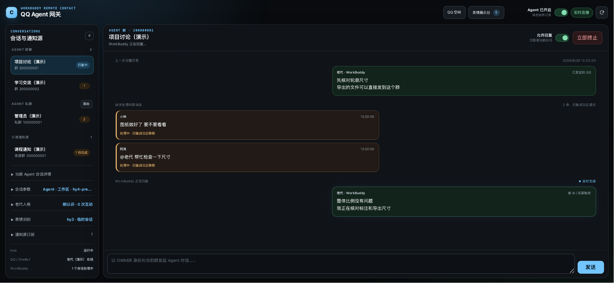
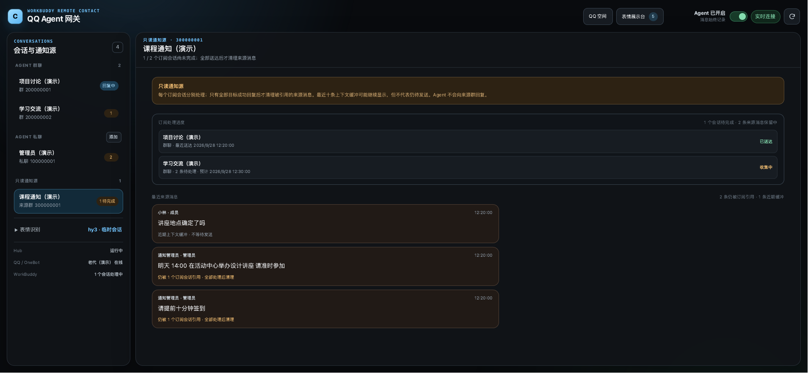
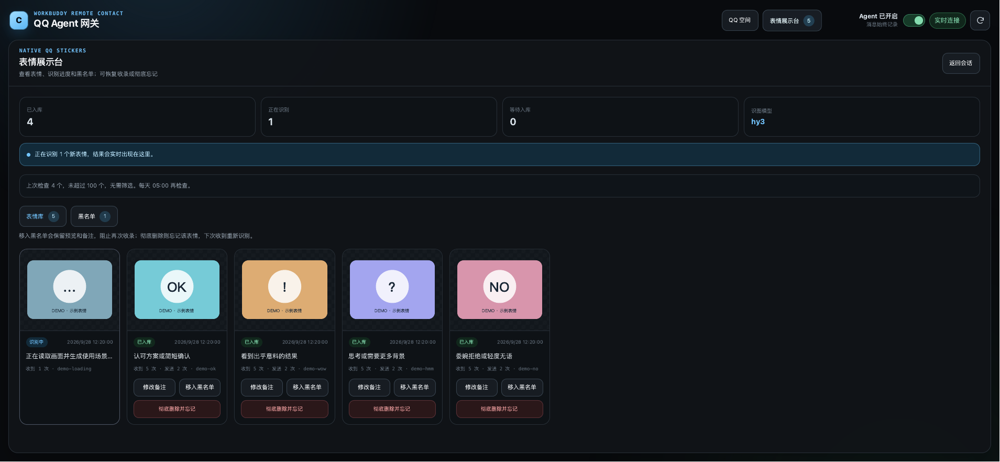
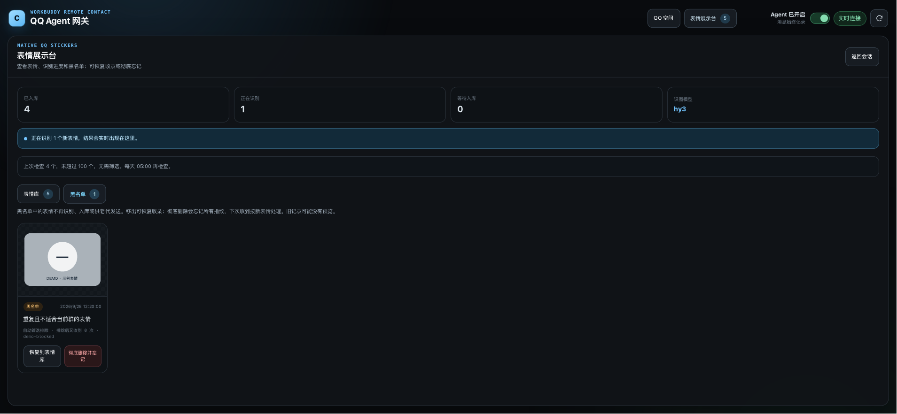
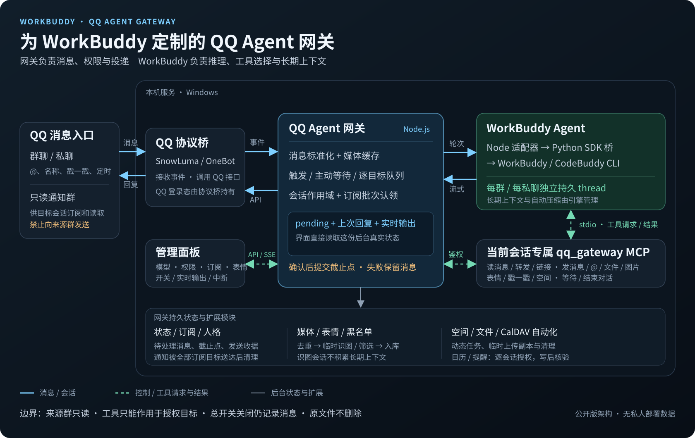

# WorkBuddy QQ Agent 网关

这是以 WorkBuddy / CodeBuddy 为默认引擎的 QQ Agent 网关。每个群聊、私聊拥有独立持久会话；网页控制台可查看实时输出、调整模型与权限、管理通知订阅和表情包。新环境从[安装与首次运行](../docs/GETTING_STARTED.md)开始。

本仓库独立发布，不是 GitHub fork。代码直接衍生自 [DrivingGodJ/workbuddy-qq-agent-gateway](https://github.com/DrivingGodJ/workbuddy-qq-agent-gateway)，其中包含源自 [Epic0522/Codex-Remote-Contact](https://github.com/Epic0522/Codex-Remote-Contact) 的代码；默认引擎、MCP 工具、持久会话、权限与部署流程均围绕 WorkBuddy 设计；Codex 适配仅作为兼容路径保留，不代表两者功能完全一致。上游许可信息尚待明确：公开源码不等同于已取得完整开源许可。当前来源与许可说明见[根目录许可证说明](../LICENSE-NOTICE.md)。

## 页面展示

以下为项目真实前端的页面展示图，使用独立演示数据，由浏览器以屏幕样式渲染后转成图片。群号、昵称、消息、会话标识和表情均为合成内容，不连接真实 QQ 或模型，不包含部署者的聊天记录。

### 群聊与实时输出

只显示上次完整回复、待处理消息和实时输出。新消息跟随到底部；查看历史时不会强行跳回。支持总开关、单会话回复开关和立即终止。



### 会话参数与权限

按会话设置模型、推理强度、压缩阈值和执行权限。所有会话固定使用 Agent 模式；模型列表来自当前引擎，WorkBuddy 目前提供全局推理档位，不是逐模型能力矩阵，界面会说明局限。

日历功能使用配置好的 CalDAV 服务；未配置时明确显示不可用。当前设置入口位于“设置与用量”。

### 只读通知源和订阅进度

来源通知按目标分别排队和汇总。所有需要该批通知的订阅者都成功送达后，才清理来源消息。

新模式“仅推送已确认负责人的通知”会对批次逐条分类，闲聊不推送，不确定内容保留待核查。来源的“设置与用量 → 通知负责人”支持按 QQ 号指定、候选确认/拒绝和资格撤销。候选根据模型判定的多日通知证据产生，确认前不获得推送资格；原有全部消息与管理员触发模式保留。

已启用订阅旁的“补漏”可扫描指定时段的群历史，默认48小时、最多回看7天，每批最多500条。先预览原发送时间和内容，再勾选需要补做的消息；首次基线不明或扫描不完整时需分别确认。刷新或Hub重启后可继续扫描，确认中断则按原选择继续提交。扫描预览不会调用模型、推送QQ或写日历。

补漏默认只生成摘要。只有单独勾选日历权限，且事项时间明确、执行时仍未开始或到期，才允许日历动作；过期事项仅摘要。补漏复用原通知筛选、投递与失败重试，逐目标持久去重，不改变实时通知的静默等待。空页、截断和无效元数据会显示部分结果；历史附件、撤回消息及跨版本覆盖不保证完整。

当前分支还实现了Hub启动/连接恢复后的有限自动扫描：记录采集连接与未观测区间，2分钟重叠、最多48小时回看，每目标自动总预算3页，跨重启保持。结果进入同一补漏弹窗，仍须人工确认，不自动投递QQ或写日历。新环境从首次可靠基线开始记录，历史接口覆盖和真实断线恢复需在自己的环境核对；项目总览与使用边界见[根README](../README.md)。



### 表情库与黑名单

实时显示识别状态，可修改使用场景、加入黑名单、恢复或彻底忘记。预览为项目自制演示图，不是真实收藏。





## 主要能力

- 每个群、私聊独立持久 thread；重启续接，失败不偷偷新建会话。
- 每个群的本机工作目录自动维护独立的 `qq-members.json`，记录发过言者的 QQ 号、现用昵称和曾用名；Agent 需要找人时才按需读取，不把名单塞进每轮提示词。文件默认位于被 Git 忽略的 `runtime/group-workspaces/`，不会随源码发布。
- 当前会话专属 MCP：读消息、展开合并转发、读公开链接；发文字、真正 @、文件、图片、原生表情和群戳一戳。可连续回复多条、主动等待或沉默。
- @机器人、提到当前 AI 昵称、群内戳一戳即时触发。默认每十分钟有新消息才自动判断；正常轮次结束后保持两分钟接话窗口，新消息立即续接。
- 目标会话主动订阅只读通知群。全部消息 / 群管触发可选；群管模式包含此前十条、触发消息和等待期全部消息。每条新消息重置等待截止时间。
- 订阅仅自动处理，必须总结发回原目标；每轮只处理一个来源。忙碌会话排队，所有引用者成功处理后才释放来源消息。
- 发送确认后提交 cutoff，失败保留 pending；已成功的动作有记录，重试避免重复发送。前端不另存一份聊天历史。
- 每个目标独立授权日历/提醒：通过显式配置的 CalDAV 写入带提醒的日程与待办事件；写后回读并在 QQ 确认。
- 原生表情先按商城 ID、SHA-256、MD5 去重，再在临时会话识图。黑名单阻止重复识别与使用。每天北京时间 05:00 检查，超过 100 个时筛选保留 80 个。
- QQ 空间绑定会话、定时纯文字动态、整点好友动态检查；按最近阅读的动态发布时间增量检查。绑定会话会实时显示任务排队、检查、阅读与互动状态；没有新动态时不会启动 AI。手动操作仅 OWNER 授权，自动功能默认关闭。
- 所有会话共用一份固定人格；面板可编辑 AI 昵称和带使用场景的口头禅。昵称保存后更新文字唤醒词和下一轮人格称谓；口头禅增减在下次北京时间 04:00 与每日表达总结一起发布。每日总结不再为每轮生成精力、熟悉度等人格运行态。公开版不包含私人问卷和学习结果。
- Windows 原生 PowerShell 前台启动，后台部署需自行配置。发送临时副本及时清理，原件不动。

## 架构



[查看可编辑矢量原图](docs/architecture.svg)。图中蓝线为消息 / 会话流，绿虚线为控制或工具请求与结果，灰线为后台状态与扩展模块。

长期上下文由引擎 thread 保存，网关只保留活动消息、发送收据和必要订阅引用。

WorkBuddy 通过当前会话专属 MCP 读取消息和执行 QQ 操作，不直接持有 QQ 接口凭证。网关负责校验身份、权限与发送目标；只读来源不能接收回复，全部订阅目标送达后才清理被引用的通知。

固定的工具、安全边界、通知整理和 QQ 空间定时任务规则放在 WorkBuddy 的共用系统提示词中；普通 Agent 轮次只补预读消息与本轮权限。预读取和面板共用后台活动窗口：上一次完整回答与当前待处理消息，不再附带隐藏的最近十条发送历史或动作列表；预读使用原始文本，不再套一层转义 JSON。每页最多 40 条消息，剩余及新到消息通过 MCP 增量读取，读取本身不清理消息。消息 ID、引用关系和附件标识保留以供工具准确操作。普通聊天与定时动态共用消息和动态 MCP 工具，但每次调用仍按本轮身份、目标和任务核验；定时任务不预塞群消息，按需读取也不清理 pending。AUTO 通知订阅仍用只读来源工具和结构化回复。

### 紧凑输入与运行诊断

- 消息页使用一次性发言者对照与简短时间/消息 ID，保留原文、引用关系和图片输入；权限只在本轮入口提供，不在每页重复。
- `list_reactions(query, offset, limit)` 本地检索场景标签，默认每类最多 8 个候选，上限 20；需要更多时分页，不把完整收藏塞进上下文。
- 固定人格包含最多 8 个、总计不超过 1200 字符的情境示范；稳定注入系统提示词，不逐轮追加。每日总结仍更新原有表达规则；内容未变时不刷新系统提示词。
- 普通聊天必须用 MCP 发送。明确沉默可正常结束，或仅输出 `NO_REPLY`；网关不代发最终文字，也不为这个标记再启动发送补救轮次。
- 左栏只保留会话导航，设置集中到右侧抽屉。显示生成、工具、压缩、接话倒计时、排队与失败；流式文字采用局部更新。
- 当前会话设置中可“删除网关会话”：确认后移出白名单、归档本地状态，并解除该目标的通知订阅与动态绑定。不会退群、删好友或销毁 WorkBuddy 历史/共享工作区。任务运行期间暂不允许删除；重新添加会建立新会话。归档在私有数据目录的 `removed-targets/`，移除标记防止重启或 OWNER 默认规则重新添加目标。
- 诊断按会话保留本次进程中的最近一轮输入预览和 SDK 原始用量，缺失字段显示“未提供”，不是 WorkBuddy 额度账单。预览最多 32000 字符，真实输入不因此截断；不额外积累长期聊天记录。

## 环境要求与启动

- Windows、PowerShell 7、Node.js 22+、Python 3.10+。
- 已安装、已登录兼容 WorkBuddy / CodeBuddy CLI，模型调用消耗自己的账号额度。
- 现有兼容 OneBot 的 QQ 桥和独立机器人账号；不附带产品、登录数据或真实配置。

同机桥默认使用 local 文件传输；NapCat Framework 是可选桥方案之一。空间、商城表情和上传扩展接口需按所用桥核验。可显式配置 Docker，不自动安装或恢复容器。

```powershell
# 以下命令在 workbuddy-qq-agent-gateway 目录执行
& .\modules\workbuddy-agent\setup.ps1
Copy-Item .\config\qq-only.windows.env.example .\config\qq-only.env
# 填写不同的 OWNER/BOT QQ 号、桥地址、CLI 路径与本地凭据
& .\modules\run-qq-only.ps1
```

已有私有配置时直接使用 `-EnvFile 'C:/path/to/qq-only.env'`。环境中的同名变量优先；不提交令牌、人格或运行数据。通用安装、CLI 登录和 CalDAV 配置先见[安装与首次运行](../docs/GETTING_STARTED.md)；补充说明见 [Windows 启动说明](docs/WINDOWS.md)、[部署说明](docs/DEPLOYMENT.md) 和 [本地可编辑结构](docs/LOCAL_CUSTOMIZATION.md)。

面板地址：http://127.0.0.1:3789/client.html，首次填入 Hub 令牌。缺少身份或凭证会拒绝启动。默认鉴权开启，不允许非 loopback 地址免鉴权。OneBot 回调地址为 http://127.0.0.1:3789/api/onebot/event，并使用一致的回调令牌或签名。

启动后在左侧“Agent 群聊 / Agent 私聊”添加目标；来源群只能作为只读通知源。白名单即时保存到私有 settings；新群不会自动获得整机权限。已有同名部署不要启动第二份。

## 不登录也能看演示

~~~bash
npm run demo
~~~

访问 http://127.0.0.1:3790/client.html。演示服使用实际前端，只返回合成状态，拒绝修改请求，不读取真实网关、凭据或消息，不调用模型。README 页面图均出自演示服。

## 模式与权限

| 设置 | 含义 |
| --- | --- |
| Agent | 按有效执行权限使用工具，完成任务 |
| 只读 | 不修改本机文件 |
| 工作区写入 | 只写当前会话隔离工作区 |
| 完全访问 | 高风险：该可信群成员可通过 Agent 访问整台电脑，不只是发文件 |

通知轮次不继承整机访问权限。只读执行权限由受限工具集实现，不进入 WorkBuddy Plan 模式。日历与提醒写入默认关闭，需每个会话明确开启，由网关单独执行授权检查。空间自动化默认关闭，发布权限限 OWNER。

来源群、图片文字、引用、转发、网页和好友动态均不可信，不能改变权限或发送目标。公开链接读取有 IP/重定向/大小限制，不带 QQ Cookie 或登录态；文件校验解析真实路径，软链接不能突破发送范围。

runtime、data、实际环境文件、日志、工作区、表情/图片、会话映射、虚拟环境均不入库。不要用 git add -f 绕过。见 [安全说明](../SECURITY.md)。

## 开发与验证

~~~bash
npm test
& .\modules\workbuddy-agent\setup.ps1
& .\modules\workbuddy-agent\.venv\Scripts\python.exe test/workbuddy-bridge-recovery.test.py
npm run audit:public
~~~

测试使用合成身份和临时目录，无需 QQ，不调用真实模型、不发布动态或改日历。CI 使用 Windows，图片处理通过共享 Pillow 实现验证。真实 QQ 和上游 CLI 集成需在自己的环境验收。

| 目录 | 内容 |
| --- | --- |
| src/groups、src/qq | 队列、触发、收发、MCP、表情和空间 |
| src/storage、src/security | 持久状态、订阅引用和权限 |
| src/workbuddy、modules/workbuddy-agent | 客户端、Python 桥、stdio MCP |
| src/persona、persona | 共用人格、每日表达摘要与通用模板 |
| modules/web-console | 网页控制台 |
| scripts、test、test-support | 自动化、恢复、演示、审计和离线测试 |

## 已知限制

- QQ 风控、登录、扫码过期及接口变动取决于 QQ 桥，建议独立小号。
- WorkBuddy 只提供当前 CLI 公开的能力。压缩阈值不是模型最大窗口或费用上限。
- 普通回复只按连续无模型进展时间判断超时：推理、工具调用、网页或文件处理、文字生成等真实进展都会重新开始 3 分钟计时，QQ 发送动作本身不作为特殊续时条件，也没有整轮总时长上限。上下文压缩使用独立的绝对 6 分钟上限，压缩期间的进展不会延长这 6 分钟。超时中断会保留未处理消息，模型参数变更也不会断开正在运行的轮次。
- SnowLuma 未提供评论列表和指定评论回复接口时，网关不伪造这些能力。
- 图片/文件上传受 QQ 和网络影响；已提交的发送不能撤回。动态结果不确定时不自动重试。
- CalDAV 需要可写日历和有效凭据；会话日历授权与本机文件权限分别检查。

## 来源与许可

感谢原作者 [Epic0522](https://github.com/Epic0522) 及后续扩展作者。本公开源码版使用脱敏快照与全新提交历史，不上传原工程历史、私人数据或登录凭证。上游许可信息包含未声明和 NOASSERTION / Other，尚不足以确认整仓完整授权；不擅自给整仓标注 MIT / Apache。详见[来源与许可证说明](../LICENSE-NOTICE.md)。
